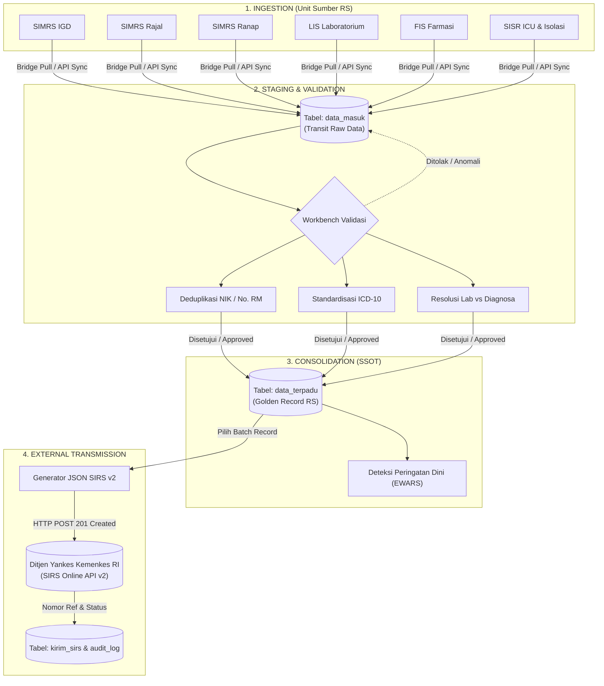
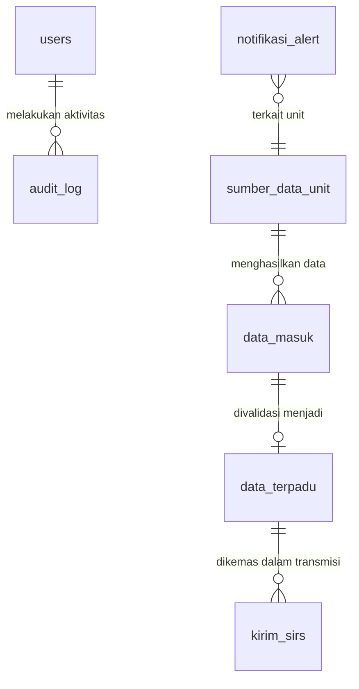
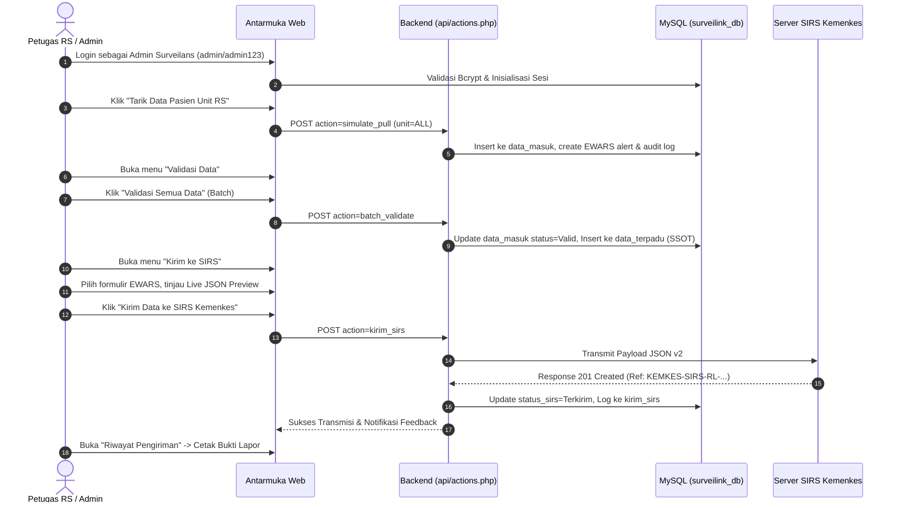

# PRODUCT REQUIREMENTS DOCUMENT (PRD)
## SurveiLink - Sistem Integrasi & Sinkronisasi Data Surveilans Rumah Sakit

---

### Informasi Dokumen
| Informasi | Deskripsi |
| :--- | :--- |
| **Nama Produk** | **SurveiLink** (*Hospital Surveillance Data Integration & Synchronization System*) |
| **Versi Dokumen** | 1.0.0 (Final Release) |
| **Status** | Disetujui (*Approved*) |
| **Konteks Kasus** | Kasus 2: Integrasi & Sinkronisasi Data Surveilans Rumah Sakit |
| **Standar Eksternal** | SIRS Online Kemenkes RI API v2, ICD-10, LOINC, Dukcapil / SatuSehat NIK 16-Digit |
| **Target Lingkungan** | Laragon Web Server (Apache/Nginx, PHP 8.x, MySQL 8.x/MariaDB), Intranet Rumah Sakit |
| **Tanggal Terbit** | November 2026 |
| **Penulis** | Tim Pengembang SurveiLink & Tim Epidemiologi Rumah Sakit |

---

## 1. Eksekutif Ringkasan & Latar Belakang Masalah

### 1.1. Latar Belakang
Rumah Sakit tipe rujukan dan umum menghadapi tantangan besar dalam mengelola data surveilans penyakit menular dan berpotensi Kejadian Luar Biasa (KLB). Dalam operasional rumah sakit harian, data pelayanan medis terfragmentasi ke dalam berbagai sistem informasi departemental yang berjalan secara terpisah (*siloed systems*), antara lain:
1. **SIMRS IGD** (*Instalasi Gawat Darurat*): Menangani triase awal dan diagnosa klinis sementara.
2. **SIMRS Rawat Jalan (Poliklinik)**: Menangani konsultasi spesialis dan rujukan berkala.
3. **SIMRS Rawat Inap (Bangsal)**: Menangani perawatan medis intensif, perkembangan harian pasien (*CPPT*), dan resume medis pulang.
4. **LIS (*Laboratory Information System*)**: Menangani hasil uji kultur, serologi (NS1, IgM/IgG), hematologi, dan biomolekuler (PCR/TCM GeneXpert).
5. **FIS (*Pharmacy Information System*)**: Menangani pemberian terapi antibiotik lini tinggi, antivirus, dan obat program pemerintah (OAT/FDC).
6. **SISR (*Severe & Intensive Surveillance Record* - ICU/Isolasi)**: Menangani kasus infeksi saluran napas berat (*SARI*), sepsis, dan isolasi airborne.

### 1.2. Masalah Utama (*Problem Statement*)
* **Fragmentasi & Diskrepansi Data**: Diagnosa kerja dokter di IGD sering kali tidak sinkron dengan hasil uji patologi laboratorium atau terapi obat di depo farmasi, memicu kebingungan dalam penetapan kasus suspek versus konfirmasi.
* **Duplikasi Data Identitas Pasien**: Satu pasien yang berpindah dari IGD ke Rawat Inap sering kali tercatat ganda dengan variasi penulisan nama, perbedaan penomoran registrasi, atau kesalahan entri NIK.
* **Ketiadaan *Single Source of Truth* (SSOT)**: Unit Epidemiologi dan Manajemen Rumah Sakit kesulitan mendapatkan satu basis data terpadu (*Golden Record*) yang bersih, valid, dan terstandardisasi.
* **Keterlambatan Pelaporan Eksternal ke Kemenkes RI**: Pelaporan berkala (RL 5.1, RL 5.2, RL 5.3, RL 5.4) dan pelaporan mingguan/harian EWARS (*Early Warning Alert and Response System*) masih kerap dilakukan secara manual, rawan kesalahan format (*rejection error*), dan lambat dalam mendeteksi eskalasi wabah.

### 1.3. Visi & Tujuan Produk (*Product Vision & Objectives*)
**SurveiLink** hadir sebagai platform dashboard terpadu dan jembatan integrasi (*integration bridge*) yang menghubungkan seluruh subsistem rumah sakit untuk:
1. Mengintegrasikan dan menelan (*ingest*) data surveilans dari 6 unit rumah sakit ke dalam *staging area* terpusat.
2. Menyediakan sarana verifikasi, deduplikasi NIK/No. RM, standardisasi kode ICD-10, dan resolusi anomali klinis.
3. Membentuk **Data Terpadu (*Single Source of Truth / Golden Record*)** yang valid dan siap audit.
4. Mengotomatiskan sinkronisasi dan transmisi data pelaporan ke **SIRS Online Kemenkes API v2** secara aman dan realtime dengan standar protokol HTTP 201 Created.
5. Mengaktifkan **Sistem Peringatan Dini (EWARS)** untuk mendeteksi lonjakan kasus berpotensi KLB (seperti DBD, ISPA Berat, TBC resisten, Campak, dan Kolera).
6. Menjamin kepatuhan regulasi rekam medis dan privasi data pasien (Permenkes) melalui pencatatan **Audit Trail** yang komprehensif.

---

## 2. Pengguna Sistem & Peran (*User Personas & RBAC*)

Sistem SurveiLink menerapkan kontrol akses berbasis peran (*Role-Based Access Control* - RBAC) yang terbagi dalam 4 peran utama:

| Peran (*Role*) | Kode Sistem | Cakupan Tugas & Tanggung Jawab | Hak Akses Utama |
| :--- | :--- | :--- | :--- |
| **Admin Epidemiologi & Surveilans** | `admin_surveilans` | Dokter spesialis / Tim Epidemiolog penanggung jawab surveilans mutu rumah sakit. Mengawasi tren wabah, melakukan validasi akhir, dan mengotorisasi pengiriman data ke Kemenkes. | Akses Penuh: Monitoring Dashboard, Ping Unit, Tarik Data, Validasi/Tolak Data, Transmisi SIRS, Kelola Alert EWARS, Reset Data Demo, Ekspor Laporan. |
| **Petugas Rekam Medis (RMIK)** | `petugas_rekam_medis` | Perekam medis yang bertugas memverifikasi kelengkapan identitas pasien, nomor rekam medis, NIK 16-digit Dukcapil, koding ICD-10, dan kelengkapan formulir RL. | Akses Data Masuk, Workbench Validasi Data, Master Data Terpadu, Ekspor CSV Data Terpadu, Riwayat Pengiriman. |
| **Admin Unit Pelayanan (IGD / Bangsal)** | `admin_unit` | Perawat / Staf administrasi unit pelayanan klinis (IGD, Ranap, Rajal, Lab, ICU). Menginput pasien manual saat darurat, memverifikasi status koneksi unit, dan memantau status kirim. | Input Pasien Manual, Edit Data Pasien Staging Unitnya, Monitoring Status Sumber Data, Lihat Dashboard. |
| **Supervisor / Direksi RS** | `supervisor` | Manajemen eksekutif rumah sakit yang membutuhkan visibilitas terhadap kepatuhan pelaporan Kemenkes, indeks tren epidemiologi, dan catatan audit keamanan. | Akses Read-Only Eksekutif: Dashboard Indikator KPI, Master Data Terpadu, Riwayat Pengiriman, Audit Log Trail. |

---

## 3. Arsitektur Sistem & Alur Pipeline Integrasi

### 3.1. Diagram Alur Pipeline Data 4-Tahap
Data diproses melalui pipeline terstruktur guna menjamin integritas sebelum ditransmisikan ke server eksternal:



### 3.2. Topologi Konektivitas 6 Unit RS Sumber Data
SurveiLink terhubung ke 6 endpoint jaringan lokal (*hospital intranet*):

1. **IGD (`SIMRS IGD v4.2`)**: `http://192.168.10.12/simrs-igd/api` (Latensi rata-rata: ~12 ms)
2. **RAJAL (`SIMRS Poliklinik Terpadu`)**: `http://192.168.10.14/simrs-rajal/api` (Latensi rata-rata: ~15 ms)
3. **RANAP (`SIMRS Inpatient Care`)**: `http://192.168.10.15/simrs-ranap/api` (Latensi rata-rata: ~18 ms)
4. **LAB (`LIS MediLab Express`)**: `http://192.168.20.10/lis/api` (Latensi rata-rata: ~9 ms)
5. **FARM (`FIS MediPharma Hospital`)**: `http://192.168.20.25/fis/api` (Latensi rata-rata: ~11 ms)
6. **ICU (`SISR Critical Surveillance`)**: `http://192.168.30.5/sisr/api` (Latensi rata-rata: ~14 ms)

---

## 4. Model Data & Skema Database (`surveilink_db`)

Database dibangun menggunakan relasi InnoDB dengan penanganan integritas transaksi dan audit logging:



### 4.1. Kamus Data Tabel Utama

#### 1. Tabel `users`
Menyimpan akun petugas otorisasi surveilans dan staf medis.
* `id` (INT PK, Auto Increment)
* `username` (VARCHAR 50, UNIQUE)
* `password` (VARCHAR 255, Bcrypt Hash)
* `nama_lengkap` (VARCHAR 100)
* `email` (VARCHAR 100)
* `role` (ENUM: `admin_surveilans`, `petugas_rekam_medis`, `admin_unit`, `supervisor`)
* `unit` (VARCHAR 100)
* `foto` (VARCHAR 255)
* `created_at` (TIMESTAMP)

#### 2. Tabel `sirs_config`
Menyimpan kredensial konfigurasi handshake API Kemenkes.
* `id` (INT PK, Default 1)
* `kode_rs` (VARCHAR 20, Default `3171012`)
* `nama_rs` (VARCHAR 150, Default `RSUD Mitra Sehat Kemenkes`)
* `kelas_rs` (VARCHAR 50, Default `Kelas B Pendidikan`)
* `api_endpoint` (VARCHAR 255, URL SIRS API v2)
* `api_key` (VARCHAR 100)
* `secret_key` (VARCHAR 100)
* `status_koneksi` (VARCHAR 50)
* `last_ping` (DATETIME)

#### 3. Tabel `sumber_data_unit`
Memantau status koneksi, latensi, dan statistik 6 unit sumber RS.
* `id` (INT PK)
* `kode_unit` (VARCHAR 20, UNIQUE: `IGD`, `RAJAL`, `RANAP`, `LAB`, `FARM`, `ICU`)
* `nama_unit` (VARCHAR 100)
* `tipe_sistem` (VARCHAR 50)
* `lokasi_server` (VARCHAR 100)
* `endpoint_url` (VARCHAR 255)
* `status_koneksi` (ENUM: `Connected`, `Disconnected`, `Warning`, `Syncing`)
* `latency_ms` (INT)
* `terakhir_sinkron` (DATETIME)
* `total_data_masuk` (INT, Default 0)
* `total_anomali` (INT, Default 0)

#### 4. Tabel `data_masuk`
Staging area untuk data mentah pasien sebelum proses verifikasi/validasi.
* `id` (INT PK)
* `no_registrasi` (VARCHAR 50, UNIQUE)
* `unit_sumber` (VARCHAR 50)
* `no_rm` (VARCHAR 20)
* `nik` (VARCHAR 20)
* `nama_pasien` (VARCHAR 100)
* `jenis_kelamin` (ENUM: `L`, `P`)
* `cara_pembayaran` (VARCHAR 50: `Pembayaran BPJS`, `Pembayaran Umum`, `Pembayaran Asuransi`)
* `tempat_lahir` (VARCHAR 100)
* `tanggal_lahir` (DATE)
* `usia` (INT)
* `agama` (VARCHAR 50)
* `status_perkawinan` (VARCHAR 50)
* `alamat` (TEXT)
* `kelurahan`, `kecamatan`, `kota_kab` (VARCHAR 100)
* `tanggal_masuk` (DATETIME)
* `diagnosa_awal` (VARCHAR 255)
* `kode_icd10` (VARCHAR 10)
* `kategori_penyakit` (VARCHAR 100)
* `hasil_lab` (VARCHAR 255)
* `terapi_farmasi` (TEXT)
* `status_kelengkapan` (ENUM: `Lengkap`, `Tidak Lengkap`, `Duplikat`, `Anomali`)
* `status_validasi` (ENUM: `Menunggu`, `Valid`, `Ditolak`, `Konflik`)
* `catatan_anomali` (TEXT)
* `created_at` (TIMESTAMP)

#### 5. Tabel `data_terpadu` (*Single Source of Truth / Golden Record*)
Master data surveilans terkonsolidasi yang siap dilaporkan ke SIRS.
* `id` (INT PK)
* `data_masuk_id` (INT, Relasi ke `data_masuk`)
* `no_rm` (VARCHAR 20)
* `nik` (VARCHAR 20)
* `nama_pasien` (VARCHAR 100)
* `jenis_kelamin` (ENUM: `L`, `P`)
* `cara_pembayaran` (VARCHAR 50)
* `tempat_lahir` (VARCHAR 100)
* `tanggal_lahir` (DATE)
* `usia` (INT)
* `agama` (VARCHAR 50)
* `status_perkawinan` (VARCHAR 50)
* `alamat_lengkap` (TEXT)
* `unit_layanan` (VARCHAR 100)
* `tanggal_masuk` (DATETIME)
* `tanggal_keluar` (DATETIME NULL)
* `kondisi_keluar` (VARCHAR 50)
* `kode_icd10` (VARCHAR 10)
* `nama_penyakit` (VARCHAR 255)
* `kategori_surveilans` (VARCHAR 100)
* `hasil_lab_terpadu` (VARCHAR 255)
* `status_sirs` (ENUM: `Belum Dikirim`, `Dalam Antrean`, `Terkirim`, `Gagal`)
* `tgl_validasi` (DATETIME)
* `petugas_validasi` (VARCHAR 100)
* `created_at` (TIMESTAMP)

#### 6. Tabel `kirim_sirs`
Log rekam jejak transmisi eksternal ke Kemenkes API v2.
* `id` (INT PK)
* `kode_transmisi` (VARCHAR 50, UNIQUE)
* `jenis_laporan` (VARCHAR 100)
* `periode_laporan` (VARCHAR 50)
* `jumlah_data` (INT)
* `payload_json` (LONGTEXT)
* `response_code` (VARCHAR 50, e.g. `201 Created`)
* `response_message` (TEXT)
* `nomor_referensi_sirs` (VARCHAR 100)
* `status_pengiriman` (ENUM: `Sukses`, `Gagal`, `Pending`, `Antrean`)
* `dikirim_oleh` (VARCHAR 100)
* `waktu_pengiriman` (DATETIME)

#### 7. Tabel `notifikasi_alert`
Deteksi dini Kejadian Luar Biasa (EWARS) dan status keterlambatan unit.
* `id` (INT PK)
* `tipe_alert` (ENUM: `EWARS_KLB`, `INTEGRASI_TERPUTUS`, `VALIDASI_ANOMALI`, `SIRS_FEEDBACK`, `INFO`)
* `judul` (VARCHAR 255)
* `pesan` (TEXT)
* `tingkat_urgensi` (ENUM: `Bahaya`, `Peringatan`, `Info`)
* `unit_terkait` (VARCHAR 50)
* `status_baca` (TINYINT 1)
* `created_at` (TIMESTAMP)

#### 8. Tabel `audit_log`
Catatan jejak kepatuhan dan audit trail keamanan rekam medis.
* `id` (INT PK)
* `user_id` (INT NULL)
* `username` (VARCHAR 50)
* `role` (VARCHAR 50)
* `aktivitas` (VARCHAR 100)
* `modul` (VARCHAR 50)
* `detail` (TEXT)
* `ip_address` (VARCHAR 45)
* `waktu` (DATETIME)

---

## 5. Rincian Kebutuhan Fungsional (*Functional Requirements*)

### 5.1. Modul Autentikasi & Akun Petugas (`login.php`, `register.php`)
* **FR-01.1**: Sistem harus menyediakan form autentikasi berbasis session PHP dengan enkripsi kata sandi Bcrypt.
* **FR-01.2**: Sistem harus menyediakan fitur *Quick Demo Fill* (Login 1-Klik) untuk 3 profil pengguna bawaan:
  1. *Admin Epidemiologi & Surveilans* (`admin` / `admin123`)
  2. *Petugas Rekam Medis* (`petugas_rm` / `admin123`)
  3. *Admin Unit IGD* (`unit_igd` / `admin123`)
* **FR-01.3**: Sistem harus menyediakan form pendaftaran petugas baru (`register.php`) dengan validasi format email, konfirmasi password, proteksi duplikasi username, dan pencatatan otomatis ke `audit_log` serta notifikasi sistem.
* **FR-01.4**: Sistem harus menangani logout aman, membersihkan sesi, dan mencatat waktu logout pengguna ke `audit_log`.

### 5.2. Dashboard Utama Surveilans (`dashboard.php`)
* **FR-02.1**: Menampilkan 5 kartu KPI Utama secara realtime:
  1. *Total Data Masuk* (Staging dari 6 unit)
  2. *Menunggu Validasi* (Antrean deduplikasi & verifikasi)
  3. *Data Terpadu (Single Source of Truth)*
  4. *Terkirim ke SIRS* (Jumlah batch transmisi sukses)
  5. *Peringatan Dini EWARS* (Jumlah notifikasi belum dibaca)
* **FR-02.2**: Visualisasi distribusi penyakit berpotensi wabah (DBD, TBC, ISPA Berat, Kolera, Campak) berdasarkan data aktual.
* **FR-02.3**: Status konektivitas ringkas 6 unit sumber rumah sakit dan latensi intranet.
* **FR-02.4**: Bilah Aksi Cepat Simulasi:
  - Tombol **"Tarik Data Unit RS"**: Ingest data sampel realistis.
  - Tombol **"Reset Data (0)"**: Mengembalikan seluruh data operasional ke angka 0 untuk pengujian kondisi awal (*empty state*).

### 5.3. Monitoring Sumber Data Unit (`sumber_data.php`)
* **FR-03.1**: Menampilkan kartu status 6 unit faskes (IGD, Rajal, Ranap, Lab, Farmasi, ICU) mencakup nama sistem, URL endpoint, IP address, waktu sinkronisasi terakhir, jumlah data masuk, dan anomali.
* **FR-03.2**: Fitur **"Tes Ping Unit"** interaktif via AJAX untuk memeriksa detak jantung (*heartbeat*) koneksi dan mengukur latensi jaringan secara realtime.
* **FR-03.3**: Fitur **"Tarik Data Unit"** per unit spesifik maupun secara menyeluruh (*ALL Units*).

### 5.4. Staging Data Masuk (`data_masuk.php`)
* **FR-04.1**: Repositori transit data mentah yang ditarik dari SIMRS, LIS, dan FIS.
* **FR-04.2**: Toolbar pencarian data pasien berdasarkan No. RM, NIK, Nama Pasien, atau Diagnosa.
* **FR-04.3**: Filter dinamis berdasarkan Unit Sumber (IGD, Rajal, Ranap, Lab, ICU) dan Status Validasi (Menunggu, Valid, Ditolak).
* **FR-04.4**: Modal **"Input Pasien Manual"** untuk penambahan data kasus darurat dengan validasi kelengkapan field (No. RM, NIK 16 digit, Nama, Jenis Kelamin, Usia, Cara Pembayaran BPJS/Umum/Asuransi, Diagnosa, ICD-10, Hasil Lab).
* **FR-04.5**: Modal **"Edit Data Pasien"** dengan kemampuan sinkronisasi otomatis ke `data_terpadu` apabila data tersebut sudah pernah divalidasi.
* **FR-04.6**: Tombol **"Hapus Data Pasien"** yang menghapus data staging sekaligus membersihkan entri terkait di `data_terpadu` serta memperbarui statistik hitungan unit.

### 5.5. Workbench Validasi Data (`validasi_data.php`)
* **FR-05.1**: Tabulasi antrean validasi: *Antrean Validasi (Menunggu)*, *Tervalidasi / Terkonsolidasi*, dan *Anomali / Ditolak*.
* **FR-05.2**: Penerapan 4 Aturan Validasi Integritas Kemenkes:
  1. *Validasi NIK 16-Digit*: Pencegahan karakter non-numerik atau panjang tidak sesuai.
  2. *Standardisasi Kode ICD-10*: Validasi kesesuaian kode diagnosa surveilans (A90-A91, A15.0, J18.9, A00.9, B05.9).
  3. *Konsolidasi Klinis vs Laboratorium*: Perbandingan diagnosa IGD dengan hasil uji penunjang LIS.
  4. *Kelengkapan Data Pelaporan SIRS*: Memastikan atribut demografi dan data perawatan lengkap.
* **FR-05.3**: Tombol **"Validasi 1-Klik"** per pasien: Mengubah status menjadi `Valid`, mengisi `status_kelengkapan` menjadi `Lengkap`, dan mempromosikan record ke tabel `data_terpadu` (*Golden Record*) dengan pengecekan pencegahan duplikasi (`data_masuk_id` atau `no_rm + kode_icd10`).
* **FR-05.4**: Tombol **"Tolak / Catat Anomali"**: Menyimpan alasan penolakan dan memberi flag `Ditolak` pada record.
* **FR-05.5**: Tombol **"Validasi Semua Data (Batch Validate)"**: Memproses seluruh antrean yang berstatus `Menunggu` secara massal dalam satu transaksi database.

### 5.6. Master Data Terpadu / SSOT (`data_terpadu.php`)
* **FR-06.1**: Repositori data tunggal (*Single Source of Truth*) yang telah bersih dari inkonsistensi dan duplikasi.
* **FR-06.2**: Menampilkan status keterikatan dengan SIRS (`Belum Dikirim` vs `Terkirim`).
* **FR-06.3**: Fitur pencarian dan filter berdasarkan Kategori Penyakit Surveilans dan Status SIRS.
* **FR-06.4**: Fitur **"Ekspor CSV"**: Menghasilkan file CSV terstruktur dari Golden Record untuk kebutuhan analisis lanjutan di Excel/SPSS.
* **FR-06.5**: Fitur **"Cetak Laporan"**: Tampilan ramah cetak (*print-friendly*) untuk arsip rekapitulasi laporan surveilans direksi rumah sakit.

### 5.7. Modul Pengiriman ke SIRS Kemenkes (`kirim_sirs.php`)
* **FR-07.1**: Dukungan terhadap modul pelaporan regulasi Kemenkes:
  1. *Surveilans Kasus KLB & Penyakit Menular (EWARS)*
  2. *RL 5.1: Pengunjung Rumah Sakit*
  3. *RL 5.2: Kunjungan Rawat Jalan*
  4. *RL 5.3: Daftar 10 Besar Penyakit Rawat Inap*
  5. *RL 5.4: Daftar 10 Besar Penyakit Rawat Jalan*
* **FR-07.2**: Seleksi checklist data pasien terpadu yang akan dimasukkan ke dalam paket transmisi.
* **FR-07.3**: *Live Payload JSON Preview*: Menampilkan format JSON standar API Kemenkes v2 secara dinamis saat checkbox pasien dipilih atau jenis laporan diubah.
* **FR-07.4**: Eksekusi Transmisi API:
  - Membangun payload JSON lengkap dengan metadata faskes (`kode_faskes: 3171012`, `nama_faskes`, `sistem_pengirim`, `waktu_transmisi`, `periode`, `data_pasien`).
  - Mengirimkan transmisi dan mencatat respons validasi server (`HTTP 201 Created`).
  - Menggenerasi kode transmisi unik (`TRX-SIRS-YYYYMMDD-HHmmss`) dan nomor referensi Kemenkes (`KEMKES-SIRS-RL-YYYY-XXXXXX`).
  - Memperbarui status record di `data_terpadu` menjadi `Terkirim`.
  - Mengirim notifikasi keberhasilan dan mencatat ke `audit_log`.

### 5.8. Riwayat Transmisi SIRS (`riwayat_pengiriman.php`)
* **FR-08.1**: Rekam jejak seluruh transmisi pengiriman yang telah dilakukan ke Kemenkes.
* **FR-08.2**: Menampilkan kode transmisi, nomor referensi SIRS, jenis laporan, periode, jumlah data pasien, petugas pengirim, dan cap waktu (*timestamp*).
* **FR-08.3**: Fitur **"Lihat Detail Payload JSON"** via modal dialog untuk inspeksi forensik struktur data terkirim.
* **FR-08.4**: Fitur **"Cetak Tanda Terima"**: Bukti formal pelaporan eksternal rumah sakit untuk arsip akreditasi faskes.

### 5.9. Sistem Notifikasi & Peringatan Dini EWARS (`notifikasi.php`)
* **FR-09.1**: Deteksi lonjakan kasus berpotensi Kejadian Luar Biasa (KLB) secara otomatis saat data masuk dari unit RS.
* **FR-09.2**: Klasifikasi tingkat urgensi notifikasi:
  - `Bahaya` (Merah): Lonjakan kasus fatal / wabah menular cepat (misal: SARI, Kolera, klaster DBD).
  - `Peringatan` (Kuning): Anomali diagnosa, duplikasi data berulang, atau latensi unit meningkat.
  - `Info` (Biru): Notifikasi petugas baru terdaftar, konfirmasi pengiriman SIRS sukses.
* **FR-09.3**: Aksi manajemen notifikasi: *Tandai Semua Dibaca*, *Tandai Satu Dibaca*, *Hapus Satu Notifikasi*, dan *Bersihkan Semua Notifikasi*.
* **FR-09.4**: Fitur **"Simulasi Peringatan Dini"** untuk keperluan drill / pengujian skenario KLB.

### 5.10. Audit Trail & Log Kepatuhan (`audit_log.php`)
* **FR-10.1**: Pencatatan otomatis setiap aksi pengguna (*immutable audit trail*) mencakup: ID Pengguna, Username, Role, Aktivitas, Modul, Rincian Perubahan, Alamat IP Pelaku, dan Timestamp.
* **FR-10.2**: Filter pencarian log berdasarkan Modul (Autentikasi, Data Masuk, Validasi Data, Kirim ke SIRS, Status Sumber Data, Notifikasi, System) dan kata kunci.
* **FR-10.3**: Fitur **"Ekspor Audit CSV"** untuk kepatuhan inspeksi auditor eksternal dan Komite Medik RS.
* **FR-10.4**: Fitur **"Kosongkan Log"** khusus untuk pengujian demo awal.

---

## 6. Rincian Kebutuhan Non-Fungsional (*Non-Functional Requirements*)

| Kategori | Parameter | Spesifikasi & Standar yang Dipenuhi |
| :--- | :--- | :--- |
| **Kinerja & Kecepatan (*Performance*)** | Waktu Respons | Waktu muat halaman &lt; 0.8 detik pada intranet lokal. Pemrosesan validasi batch 100 data &lt; 1.5 detik. |
| | Latensi Jaringan | Rata-rata latensi komunikasi antar-unit internal RS berkisar antara 8 ms - 22 ms. |
| **Keamanan (*Security*)** | Enkripsi Password | Algoritma `PASSWORD_BCRYPT` dengan cost standard PHP untuk seluruh password akun. |
| | Proteksi SQL Injection | 100% kueri database menggunakan PDO Prepared Statements dengan parameter binding terisolasi. |
| | Proteksi XSS | Penggunaan fungsi `htmlspecialchars()` pada seluruh luaran data dinamis pengguna di antarmuka HTML. |
| | Manajemen Sesi | PHP Native Session dengan regenerasi ID sesi dan validasi hak akses per modul. |
| **Integritas Data (*Data Integrity*)** | Transaksi ACID | Penggunaan blok `PDO::beginTransaction()`, `commit()`, dan `rollBack()` pada operasi validasi multi-tabel. |
| | Deduplikasi Unik | Pengecekan kombinasi No. RM dan Kode Diagnosa ICD-10 sebelum promosi ke Single Source of Truth. |
| **Kepatuhan Regulasi (*Compliance*)** | Standar Kemenkes | Kepatuhan format transmisi API SIRS Online v2 Ditjen Yankes Kemenkes RI. |
| | Standar NIK Dukcapil | Validasi 16 digit numerik NIK terintegrasi konsep identitas tunggal pasien SatuSehat Kemenkes. |
| | Standar Koding Medis | ICD-10 (*International Classification of Diseases 10th Revision*) & LOINC (*Logical Observation Identifiers Names and Codes*). |
| **Ketersediaan & Desain (*Usability*)** | Antarmuka Responsif | Tailwind CSS dengan tata letak adaptif desktop (min 1024px) hingga perangkat seluler (min 360px). |
| | Penanganan *Empty State* | Kondisi data awal (0 record) ditampilkan secara ramah, informatif, dan dilengkapi tombol pemantik data uji coba. |

---

## 7. Spesifikasi Antarmuka Eksternal & API

### 7.1. Struktur Payload JSON SIRS Kemenkes Online v2
SurveiLink mengemas data terpadu ke dalam format JSON payload resmi Kemenkes:

```json
{
  "kode_faskes": "3171012",
  "nama_faskes": "RSUD Mitra Sehat Kemenkes",
  "sistem_pengirim": "SurveiLink v2.0 - Hospital Surveillance Bridge",
  "waktu_transmisi": "2026-11-07T16:20:00+07:00",
  "jenis_laporan": "Surveilans Kasus KLB / Penyakit Menular (EWARS)",
  "periode": "November 2026",
  "total_kasus": 2,
  "data_pasien": [
    {
      "id_surveilink": 1,
      "no_rm": "RM-928101",
      "nik": "3171051204890001",
      "nama_pasien": "Ahmad Fauzi",
      "jenis_kelamin": "L",
      "cara_pembayaran": "Pembayaran BPJS",
      "tempat_lahir": "Jakarta",
      "tanggal_lahir": "1989-04-12",
      "usia": 37,
      "agama": "Islam",
      "status_perkawinan": "Kawin",
      "alamat": "Jl. Salemba Raya No. 14, Kenari, Senen, Jakarta Pusat",
      "icd10": "A91",
      "diagnosa": "Dengue Haemorrhagic Fever (DHF) Grade II",
      "kategori_surveilans": "Demam Berdarah Dengue (DBD)",
      "tanggal_masuk": "2026-11-07 14:00:00",
      "hasil_laboratorium": "Trombosit: 68.000 /uL, Hematokrit: 46%, NS1 Antigen: POSITIF",
      "unit_perawatan": "IGD",
      "status_pasien": "Dalam Perawatan"
    }
  ]
}
```

### 7.2. Respons Standar Server Kemenkes
```json
{
  "response_code": "201 Created",
  "status": "Sukses",
  "nomor_referensi": "KEMKES-SIRS-RL-2026-882949",
  "message": "Data surveilans berhasil diverifikasi dan disimpan ke repositori SIRS Kemenkes v2"
}
```

### 7.3. Spesifikasi Endpoint Internal AJAX (`api/actions.php`)

| Action Parameter | Metode | Parameter Masukan | Fungsi & Luaran |
| :--- | :--- | :--- | :--- |
| `reset_data` | POST | - | Mengosongkan data staging, SSOT, kirim SIRS, notifikasi, dan audit log ke status 0. |
| `simulate_pull` | POST | `unit` (`ALL`, `IGD`, `RAJAL`, `RANAP`, `LAB`, `ICU`) | Menarik sekumpulan kasus surveilans realistis ke `data_masuk`. |
| `add_patient` | POST | `no_rm`, `nik`, `nama_pasien`, `jenis_kelamin`, `cara_pembayaran`, `unit_sumber`, `alamat`, `diagnosa_awal`, `kode_icd10`, `hasil_lab`, dll. | Menyimpan data pasien manual baru ke `data_masuk`. |
| `edit_patient` | POST | `id`, seluruh atribut pasien | Memperbarui data pasien staging dan sinkronisasi ke data terpadu jika ada relasi. |
| `delete_patient` | POST | `id` | Menghapus record pasien dari `data_masuk` dan `data_terpadu`. |
| `get_patient` | GET/POST | `id` | Mengambil detail 1 record pasien untuk pengisian form modal edit. |
| `validate_data` | POST | `id`, `type` (`approve` / `reject`), `alasan` | Memvalidasi record dan mempromosikannya ke `data_terpadu` atau menandai ditolak. |
| `batch_validate`| POST | - | Memvalidasi seluruh antrean berstatus `Menunggu` ke `data_terpadu`. |
| `kirim_sirs` | POST | `ids[]`, `jenis_laporan`, `periode` | Menghasilkan payload JSON dan mengirimkan transmisi ke SIRS Online Kemenkes. |
| `ping_unit` | POST | `kode_unit` | Menguji heartbeat endpoint dan memperbarui status latensi unit. |
| `mark_all_read` | POST | - | Menandai seluruh notifikasi alert telah dibaca (`status_baca = 1`). |
| `mark_read_single` | POST | `id` | Menandai satu notifikasi alert telah dibaca. |
| `clear_notifications` | POST | - | Menghapus seluruh entri pada `notifikasi_alert`. |
| `clear_audit` | POST | - | Menghapus seluruh rekaman riwayat pada `audit_log`. |

---

## 8. Skenario Pengujian & Alur Validasi (*End-to-End Test Scenarios*)

Untuk memverifikasi kesesuaian sistem dengan spesifikasi, berikut adalah alur pengujian lengkap (*happy path* dan *anomaly path*):



### Matriks Pengujian Kasus Uji (*Test Case Matrix*)

| ID Uji | Deskripsi Kasus Uji | Langkah Pengujian | Hasil yang Diharapkan | Status |
| :--- | :--- | :--- | :--- | :--- |
| **TC-01** | Autentikasi Pengguna & Role Check | Masukkan user `admin` dan password `admin123`. | Login sukses, diarahkan ke Dashboard dengan profil Admin Surveilans. | Lolos |
| **TC-02** | Kondisi Awal Bersih (*Empty State*) | Klik "Reset Semua Data ke 0". | Seluruh kartu KPI dan tabel data bernilai 0 dengan tampilan empty state elegan. | Lolos |
| **TC-03** | Ingest Data Surveilans Multi-Unit | Klik "Tarik Data Unit RS". | Masuk 6 sampel pasien (DBD, TBC, ISPA, Campak, Kolera) ke `data_masuk`. Alert EWARS muncul. | Lolos |
| **TC-04** | Validasi NIK & Promosi ke SSOT | Klik "Validasi" pada pasien Ahmad Fauzi. | Record berpindah ke `data_terpadu`, status kelengkapan = Lengkap, audit log tercatat. | Lolos |
| **TC-05** | Pencegahan Duplikasi Record | Lakukan validasi ulang pasien dengan No. RM & ICD-10 yang sama. | Sistem mencegah duplikasi entri di `data_terpadu`. | Lolos |
| **TC-06** | Transmisi SIRS Kemenkes API v2 | Pilih 2 pasien di `kirim_sirs.php`, klik "Kirim ke SIRS". | Terbit kode transmisi `TRX-SIRS-...`, nomor referensi Kemenkes, status terkirim. | Lolos |
| **TC-07** | Ekspor CSV Master Data Terpadu | Klik tombol "Ekspor CSV" di `data_terpadu.php`. | File CSV terunduh dengan header lengkap sesuai atribut rekam medis terpadu. | Lolos |
| **TC-08** | Audit Trail Kepatuhan Permenkes | Lakukan aksi edit pasien manual, lalu buka `audit_log.php`. | Aktivitas tercatat lengkap dengan timestamp, username, modul, dan alamat IP. | Lolos |

---

## 9. Analisis Risiko & Mitigasi (*Risk Management*)

| Risiko Teridentifikasi | Tingkat Risiko | Dampak Operasional | Strategi Mitigasi Sistem SurveiLink |
| :--- | :---: | :--- | :--- |
| **Koneksi Intranet Unit RS Terputus (*Network Failure*)** | Sedang | Data surveilans unit IGD/Lab tidak dapat ditarik secara otomatis. | Indikator detak jantung di `sumber_data.php` berubah menjadi *Disconnected/Warning*; sistem menyediakan form *Input Pasien Manual* darurat. |
| **Server SIRS Kemenkes Down / RTO** | Tinggi | Gagal melakukan transmisi pelaporan berkala dan risiko teguran regulator. | Sistem menyimpan data yang telah divalidasi dalam status `Belum Dikirim` di SSOT dan mencatat status `Antrean/Pending` tanpa menghilangkan data. |
| **Diskrepansi Diagnosa Klinis vs Lab** | Tinggi | Kesalahan pengkategorian kasus epidemiologi (misal suspek DBD tanpa uji trombosit/NS1). | *Workbench Validasi* menampilkan komparasi diagnosa awal versus hasil uji LIS berdampingan sebelum promosi disetujui. |
| **Kebocoran Data Pasien (Privasi & NIK)** | Kritis | Pelanggaran kerahasiaan rekam medis Permenkes & UU PDP. | Isolasi jaringan intranet, hashing password Bcrypt, otentikasi sesi ketat, dan pencatatan seluruh aktivitas akses ke `audit_log`. |

---

## 10. Rencana Pengembangan Masa Depan (*Roadmap*)

* **Fase 1 (Selesai - Rilis Saat Ini)**:
  - Implementasi 10 Frame/Halaman Utama terintegrasi.
  - Pembentukan staging area dan *Single Source of Truth*.
  - Jembatan konektor SIRS Kemenkes API v2 (RL 5.1 - 5.4, EWARS).
  - Sistem Deteksi Dini & Audit Trail Kepatuhan.
* **Fase 2 (Q1 - Q2 2027)**:
  - Integrasi dua arah dengan platform **Kemenkes SatuSehat FHIR API** (Encounter, Condition, Observation, MedicationRequest resource).
  - Sinkronisasi otomatis berbasis cron daemon / background job scheduler tanpa perlu penarikan manual.
* **Fase 3 (Q3 - Q4 2027)**:
  - Peta Spasial GIS (*Geographic Information System*) pemetaan klaster sebaran penyakit per kelurahan/kecamatan.
  - Implementasi *Machine Learning Prediction Model* untuk memprediksi lonjakan siklus tahunan kasus DBD dan ISPA berbasis tren cuaca dan riwayat rekam medis.

---

## 11. Glosarium & Terminologi

* **SSOT (*Single Source of Truth*)**: Konsep arsitektur data di mana setiap data medis pasien disimpan dalam satu representasi definitif (*Golden Record*) yang terverifikasi dan tidak memiliki redundansi.
* **SIRS Online**: Sistem Informasi Rumah Sakit berbasis web yang dikelola oleh Kementerian Kesehatan Republik Indonesia untuk pelaporan data pelayanan faskes.
* **EWARS (*Early Warning Alert and Response System*)**: Sistem peringatan dini dan respons untuk mendeteksi potensi Kejadian Luar Biasa (KLB) penyakit menular.
* **ICD-10**: *International Statistical Classification of Diseases and Related Health Problems 10th Revision*, standar koding diagnosis penyakit WHO.
* **LIS (*Laboratory Information System*)**: Perangkat lunak khusus manajemen operasional laboratorium patologi klinik dan mikrobiologi.
* **FIS (*Pharmacy Information System*)**: Sistem informasi peresepan dan dispensasi sediaan farmasi rumah sakit.
* **CPPT**: Catatan Perkembangan Pasien Terintegrasi dalam rekam medis rumah sakit.
* **Dukcapil**: Direktorat Jenderal Kependudukan dan Pencatatan Sipil, sumber validasi NIK 16-digit resmi di Indonesia.

---
*Dokumen ini merupakan panduan resmi pengembangan, pemeliharaan, dan audit operasional sistem SurveiLink RSUD Mitra Sehat Kemenkes.*

